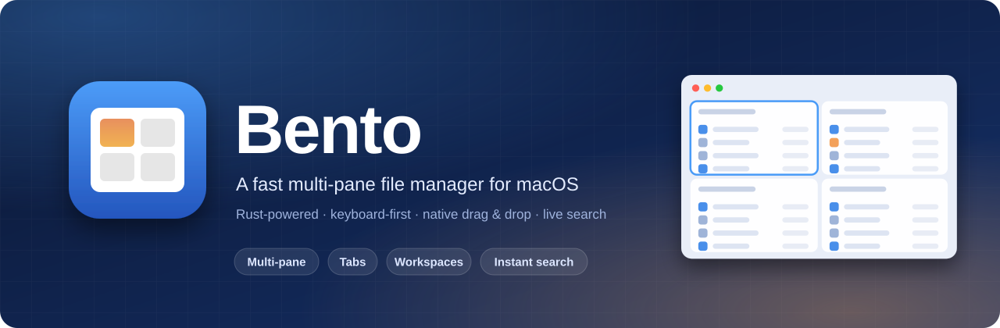
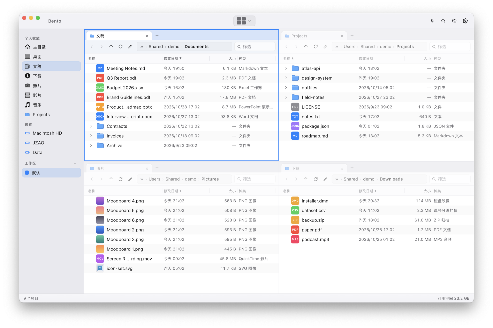
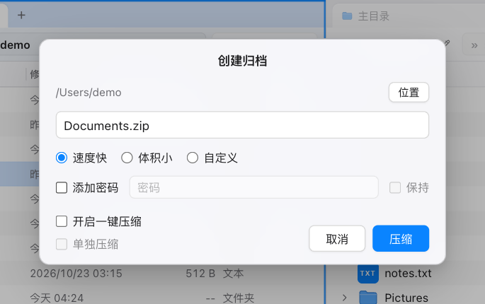
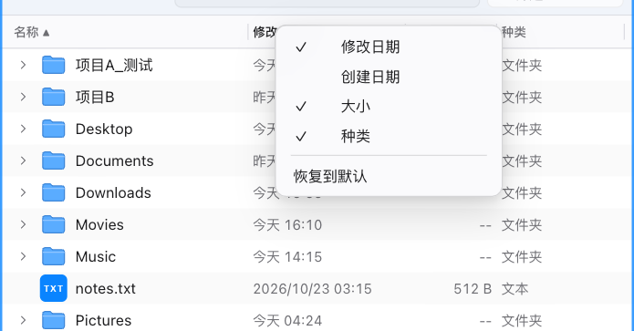
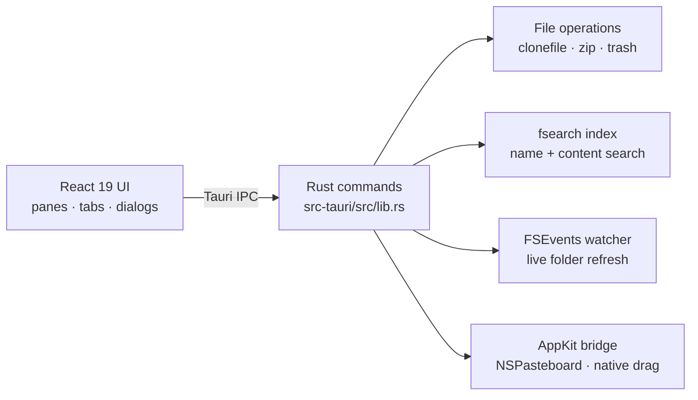

<p align="right">
  <strong>English</strong> · <a href="./README.zh-CN.md">简体中文</a>
</p>

<p align="center">
  
</p>

<p align="center">
  <a href="#install"></a>
  <a href="./LICENSE"></a>
  
  
  
</p>

<p align="center">
  <a href="#features">Features</a> ·
  <a href="#install">Install</a> ·
  <a href="#keyboard-shortcuts">Shortcuts</a> ·
  <a href="#architecture">Architecture</a> ·
  <a href="#status--limitations">Limitations</a> ·
  <a href="#acknowledgements">Credits</a>
</p>

<p align="center">
  
</p>

## Overview

**Bento** is a lightweight multi-pane file manager for macOS. It puts several folders on screen at once — like the compartments of a bento box — so moving, comparing and organising files stops being a game of window juggling.

It is built with a **Rust** backend on **Tauri 2** and a **React 19** interface, keeps the Finder conventions you already know, and adds the things power users miss: split layouts, per-pane tabs, instant search, real drag & drop with other apps, and a QSpace-style archive dialog.

> Bento is inspired by [QSpace](https://qspace.awehunt.com/). It is an independent open-source project and is not affiliated with QSpace.

## Features

| | |
| --- | --- |
| **Multi-pane layouts** | 10 presets — single, side-by-side, stacked, 2×2, and several 3-pane arrangements. Switch with <kbd>⌘1</kbd> <kbd>⌘2</kbd> <kbd>⌘4</kbd> or the layout picker. |
| **Tabs & workspaces** | Every pane has its own Finder-style tabs. Save whole layouts (panes, tabs, paths) as named workspaces in the sidebar. |
| **Instant search** | Global file-name search backed by the [fsearch](https://github.com/noahdunnagan/fsearch) index — fuzzy matching, `*` / `?` wildcards, `ext:` filters and `re:` regular expressions — plus **content search** with a side preview that highlights matching lines. |
| **Native drag & drop** | Drag files out to Finder or any other app, drop files in from anywhere, or move them between panes. It works even when Bento sits behind other windows, and drop targets are highlighted as you hover. |
| **Real clipboard** | <kbd>⌘C</kbd> puts real file URLs on the system pasteboard, so <kbd>⌘V</kbd> in Finder and other apps pastes the files themselves. |
| **Fast file operations** | APFS `clonefile` makes same-volume copies instant. Undo with <kbd>⌘Z</kbd>, duplicates are named `name copy.ext`, `name copy 1.ext`, `name copy 2.ext`, and deletions go to the Trash. |
| **Create Archive** | A QSpace-style dialog: choose location and name, speed / size / custom compression level, optional password, one-click mode and per-item archives. |
| **Batch rename** | Replace, add, format (with counters and dates) and change case, with a live before/after preview. |
| **New file** | Right-click empty space in a pane and choose **新建**: Text (`未命名.txt`), Markdown (`未命名.md`), or any file you drop in `~/Library/Application Support/com.bento.app/templates/` (for example a `.docx`). The new item is renamed immediately. A clash becomes `未命名 2.txt` and never overwrites. |
| **Flexible columns** | Name · Modified · Created · Size · Kind. Drag column borders to resize, right-click the header to choose columns — settings are **per pane**. Long names are shortened in the middle (`Product…admap.pptx`) and secondary columns hide automatically in narrow panes. |
| **Live folders** | FSEvents updates panes and expanded sub-folders as files change. File operations refresh only affected directories, even with automatic refresh disabled. Interrupted reads retain available rows and offer Retry. |
| **Keyboard-first** | Editable address bar (<kbd>⌘L</kbd>, <kbd>Tab</kbd> completes while editing), copy paths (<kbd>⌥⌘C</kbd>), <kbd>Tab</kbd> switches panes, <kbd>F5</kbd> / <kbd>F6</kbd> copy or move to the other pane, arrow-key navigation, inline folder expansion, Quick Look on <kbd>Space</kbd>, always-on-top pin (<kbd>⌥⌘T</kbd>). |
| **Remembers everything** | Window frame, layout, tabs, paths, sort order, column widths and preferences are restored on launch. Follows the system light / dark appearance. |

Name and content search both support Current Folder, Home and Global. Click a result or press Enter to open its containing folder and locate/select it in the focused pane. Hover or use the arrow keys to select or preview; the context menu’s Open action opens the item itself. Current Folder/Home scan only when you submit a search, include new unindexed files, skip directory links, and apply scope, visibility and format filters before the result cap (200 by default). Large or inaccessible trees show partial-result notices; errors offer Retry. Local scans have a 2-second soft budget, 100,000 entries, depth 64, 16 MiB per file and 64 KiB per line. Global results use the existing index/system sources and disclose uncertain coverage. Replacing a search cancels local work; an opaque index call may finish in the background while only the latest replacement waits.

<table>
  <tr>
    <td width="50%" valign="top">
      
      <p align="center"><sub><b>Create Archive</b> — compression level, password, one-click mode</sub></p>
    </td>
    <td width="50%" valign="top">
      
      <p align="center"><sub><b>Columns</b> — right-click the header to choose what to show</sub></p>
    </td>
  </tr>
</table>

## Install

### Download

Grab the latest `.dmg` from the **[Releases page](https://github.com/banduoba/bento/releases/latest)**, open it and drag **Bento** into `/Applications` (Apple Silicon, macOS).

The build is not notarized by Apple, so macOS may block the first launch. Either *right-click → Open*, or clear the download quarantine flag once:

```bash
xattr -dr com.apple.quarantine /Applications/Bento.app
```

### Build from source

Prefer to build it yourself? It takes a few minutes the first time.

**Requirements**

- macOS on Apple Silicon (the tested target)
- [Node.js](https://nodejs.org/) 18 or newer
- [Rust](https://rustup.rs/) (stable) and the Xcode Command Line Tools (`xcode-select --install`)

**Build**

```bash
git clone https://github.com/banduoba/bento.git
cd bento
npm install
npm run build
```

The app and a disk image are written to `src-tauri/target/release/bundle/` (`macos/Bento.app` and `dmg/`). Drag `Bento.app` into `/Applications`.

**Develop**

```bash
npm run dev        # Tauri dev mode with hot reload
```

**First launch**

- The app is ad-hoc signed, so macOS may ask you to confirm the first launch (*right-click → Open*).
- Grant **Full Disk Access** in *System Settings → Privacy & Security* if you want global and content search to cover protected locations. Bento shows a hint in Settings when it is missing.
- After replacing the app with a new build, macOS may drop that permission — remove and re-add Bento in the list.

## Keyboard shortcuts

<details open>
<summary><b>Common shortcuts</b></summary>

| Shortcut | Action |
| --- | --- |
| <kbd>⌘1</kbd> <kbd>⌘2</kbd> <kbd>⌘4</kbd> | One / two / four pane layout |
| <kbd>⌘T</kbd> · <kbd>⌘W</kbd> · <kbd>⌃Tab</kbd> | New tab · close tab · next tab |
| <kbd>⌘K</kbd> or <kbd>⌥⌘F</kbd> | Open search |
| <kbd>⌘L</kbd> or <kbd>⇧⌘G</kbd> | Edit the path |
| <kbd>Tab</kbd> · <kbd>⇧Tab</kbd> | Move focus between visible panes (no switch in single-pane). While the address bar is editing, Tab still completes the path |
| <kbd>F5</kbd> · <kbd>F6</kbd> | Copy / move the selection into the other pane's current folder (no-op in single-pane) |
| <kbd>⌥⌘C</kbd> | Copy the full path of the selection (one path per line) |
| <kbd>⌘[</kbd> · <kbd>⌘]</kbd> | Back · forward |
| <kbd>⌘C</kbd> · <kbd>⌘X</kbd> · <kbd>⌘V</kbd> · <kbd>⌘D</kbd> | Copy · cut · paste · duplicate |
| <kbd>⌘⌫</kbd> · <kbd>⌘Z</kbd> | Move to Trash · undo |
| <kbd>⇧⌘N</kbd> | New folder |
| <kbd>↩</kbd> | Open or rename (Settings → General → Return key; rename by default) |
| <kbd>F2</kbd> | Rename |
| <kbd>⌘↓</kbd> | Open the selection |
| <kbd>Space</kbd> | Quick Look; for one selected file, ↑ / ↓ follow the opening pane’s current file order |
| <kbd>↑</kbd> <kbd>↓</kbd> · <kbd>Home</kbd> <kbd>End</kbd> · <kbd>PgUp</kbd> <kbd>PgDn</kbd> | Move the selection |
| <kbd>→</kbd> <kbd>←</kbd> | Enter a folder / go to the parent |
| <kbd>⌫</kbd> | Go to parent folder |
| <kbd>⌘A</kbd> · <kbd>Esc</kbd> | Select all · clear selection |
| <kbd>⌘R</kbd> | Refresh |
| <kbd>⇧⌘.</kbd> | Show / hide hidden files |
| <kbd>⌥⌘S</kbd> | Toggle sidebar |
| <kbd>⌥⌘T</kbd> | Keep window on top |
| <kbd>⌘,</kbd> | Settings |

Move and Trash undo restore the original full filename. If restoration fails, the undo stays available for retry; already restored items are skipped.

</details>

## Architecture



- **Frontend** — React 19, Vite 7, [@tanstack/react-virtual](https://tanstack.com/virtual). Opening a folder streams entries in batches of about 500 over a Tauri channel, and the list mounts only the visible rows, keyed by path.
- **Backend** — Rust on Tauri 2: parallel directory scans (rayon), APFS `clonefile`, the fsearch engine, `notify` (FSEvents) for live updates, and `objc2` for the native pasteboard and window behaviour.
- **Drag & drop** — a native `NSDraggingSession` via [tauri-plugin-drag](https://github.com/crabnebula-dev/drag-rs) for dragging out, and Tauri's window drag-drop events for dragging in.

```text
src/                     React UI (App, Pane, dialogs, column and drag helpers)
src-tauri/src/lib.rs     Rust commands: files, search, clipboard, watcher, archive
src-tauri/tauri.conf.json  Window and bundle configuration
docs/                    Engineering notes and README assets
```

Hard-won implementation notes — coordinate systems for native drops, a window-state deadlock, pasteboard formats and more — are collected in [`docs/PITFALLS-drag-clipboard.md`](./docs/PITFALLS-drag-clipboard.md).

## Status & limitations

Bento is young software (`0.2.1`). Know before you use it:

- The interface is currently **Simplified Chinese only**.
- Apple Silicon on a recent macOS is the tested configuration; Intel Macs are untested.
- Local files only — there is no SFTP / SMB / cloud connection support.
- Archive passwords use traditional ZipCrypto (readable by macOS and `unzip`, but a weak cipher), and they are passed to `zip` on the command line while compressing. The *Keep* option stores the password in plain text in the config file.

## Performance baseline

Fixture generators and a headless bench live in [`scripts/bench/README.md`](./scripts/bench/README.md) (简体中文). One command builds a 10k-file folder, another builds 100k, and a third times a directory scan plus deleting three small files without opening the GUI. Cold-open first paint and new-tab timing are manual steps recorded into the same JSON report. The scripts do not change how the app lists, watches, or draws files.

## Contributing

Issues and pull requests are welcome. Please run `npm run build` and, for Rust changes, `cargo test` in `src-tauri/` before submitting. For UI changes, a screenshot or short clip helps a lot.

## Acknowledgements

- [QSpace](https://qspace.awehunt.com/) for the interaction design that inspired this project
- [fsearch](https://github.com/noahdunnagan/fsearch) — the indexing and content-search engine
- [Tauri](https://tauri.app/), [tauri-plugin-drag](https://github.com/crabnebula-dev/drag-rs), [notify](https://github.com/notify-rs/notify), [rayon](https://github.com/rayon-rs/rayon), [objc2](https://github.com/madsmtm/objc2)
- [React](https://react.dev/), [Vite](https://vite.dev/) and [TanStack Virtual](https://tanstack.com/virtual)

## License

[MIT](./LICENSE) © banduoba
