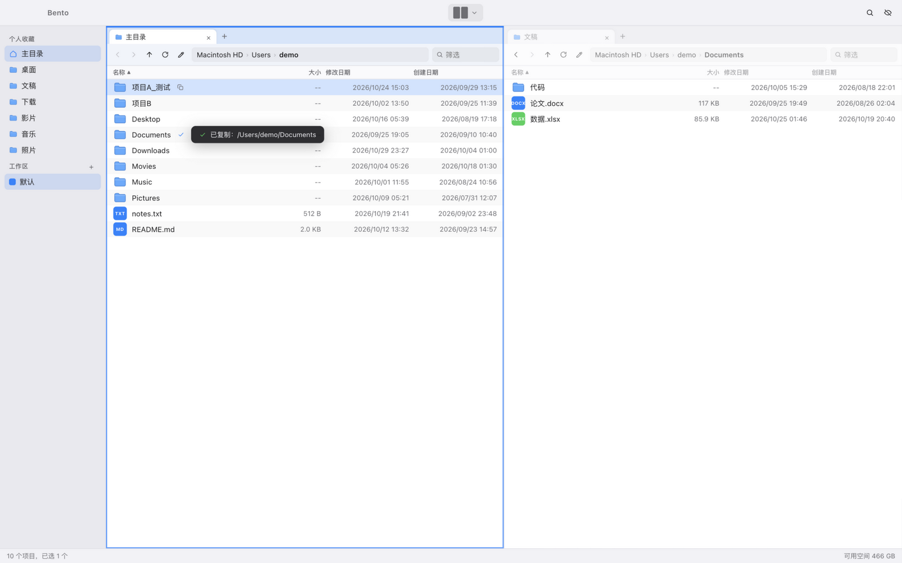

# Bento 🍱

Bento（便当）—— 轻量多窗格文件管理器（macOS）。多窗格如便当分格，各归其位。QSpace 的开源简化复刻。

A lightweight multi-pane file manager for macOS, inspired by QSpace.

-black) 



## 功能 / Features

- **多窗格**：10 种布局预设（左右分栏、四宫格、1+2 等），⌘1/⌘2/⌘4 快速切换
- **标签页**：每个窗格支持 Finder 式标签页（⌘T 新建 / ⌘W 关闭）
- **工作区**：侧边栏多工作区，各自记忆窗格布局与打开的目录
- **全局搜索**：集成 [fsearch](https://github.com/noahdunnagan/fsearch) 引擎（getattrlistbulk 全盘索引 + FSEvents 实时更新 + 模糊容错，毫秒级查询），支持 `*`/`?` 通配符、`ext:jpg` 后缀过滤、`re:` 正则
- **可编辑地址栏**：⌘L 直接编辑路径跳转，长路径自动折叠为 `»` 悬停展开
- **文件操作**：复制/剪切/粘贴（APFS clonefile 秒级拷贝）、批量重命名（替换/添加/格式化 + 实时预览）、压缩 zip、快速查看、废纸篓
- **书签与卷**：常用目录右键收藏；侧边栏列出所有挂载卷
- **状态持久化**：窗口大小/位置、布局、标签、路径、排序全部自动记忆

## 开发 / Development

```bash
npm install        # 安装前端依赖
npm run dev        # 开发模式（Rust 增量编译）
npm run build      # 构建正式版 .app / .dmg
```

要求：Node 18+、Rust、Xcode CLT。仅支持 macOS（Apple Silicon 优先）。

## 技术栈 / Stack

- **后端**：Rust + Tauri 2（rayon 并行目录扫描、clonefile 零拷贝、fsearch 索引）
- **前端**：React 19 + Vite + @tanstack/react-virtual（虚拟滚动）

## License

MIT
