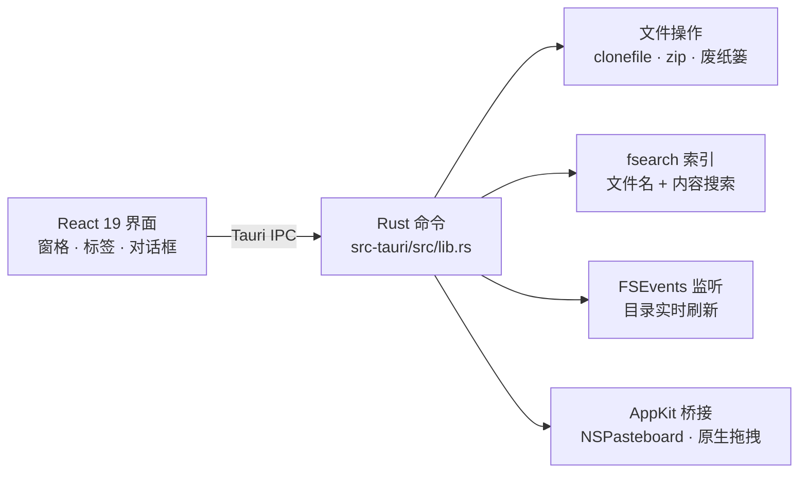

<p align="right">
  <a href="./README.md">English</a> · <strong>简体中文</strong>
</p>

<p align="center">
  
</p>

<p align="center">
  <a href="#安装"></a>
  <a href="./LICENSE"></a>
  
  
  
</p>

<p align="center">
  <a href="#功能">功能</a> ·
  <a href="#安装">安装</a> ·
  <a href="#快捷键">快捷键</a> ·
  <a href="#架构">架构</a> ·
  <a href="#现状与限制">限制</a> ·
  <a href="#致谢">致谢</a>
</p>

<p align="center">
  
</p>

## 简介

**Bento** 是一款轻量的 macOS 多窗格文件管理器。多个文件夹像便当盒的格子一样同时摆在眼前，移动、对比、整理文件不必再来回切换窗口。

后端使用 **Rust**（Tauri 2），界面使用 **React 19**。它保留你熟悉的 Finder 操作习惯，并补上进阶用户需要的能力：分屏布局、每个窗格独立的标签页、即时搜索、与其他应用互通的真实拖拽，以及 QSpace 风格的「创建归档」对话框。

> Bento 的交互设计受 [QSpace](https://qspace.awehunt.com/) 启发，是独立的开源项目，与 QSpace 官方无关。

## 功能

| | |
| --- | --- |
| **多窗格布局** | 10 种预设：单窗格、左右分栏、上下分栏、2×2 以及多种三窗格组合。<kbd>⌘1</kbd> <kbd>⌘2</kbd> <kbd>⌘4</kbd> 或工具栏布局选择器切换。 |
| **标签页与工作区** | 每个窗格各自拥有 Finder 式标签页；整套布局（窗格、标签、路径）可保存为侧边栏里的命名工作区。 |
| **即时搜索** | 基于 [fsearch](https://github.com/noahdunnagan/fsearch) 索引的全局文件名搜索：模糊匹配、`*` / `?` 通配符、`ext:` 后缀过滤、`re:` 正则；另有**内容搜索**，右侧预览并高亮命中行。 |
| **原生拖拽** | 可拖出到访达或任何其他应用，也可从任何地方拖入，或在窗格之间移动。Bento 被其他窗口遮住时也能直接拖出；悬停时目标会高亮提示。 |
| **真实剪贴板** | <kbd>⌘C</kbd> 把真实的文件 URL 写入系统剪贴板，在访达等应用里 <kbd>⌘V</kbd> 直接粘贴出文件本体。 |
| **快速文件操作** | APFS `clonefile` 让同卷拷贝瞬间完成；<kbd>⌘Z</kbd> 撤销；拷贝重名自动命名为 `名称 copy.ext`、`名称 copy 1.ext`、`名称 copy 2.ext`；删除进入废纸篓。 |
| **创建归档** | QSpace 风格的对话框：选择位置与文件名，速度快 / 体积小 / 自定义压缩级别，可选密码，支持一键压缩与单独压缩。 |
| **批量重命名** | 替换、添加、格式化（序号、日期）、大小写转换，实时预览前后对比。 |
| **新建文件** | 在窗格空白处右键「新建」：文本文件、Markdown，以及放进 `~/Library/Application Support/com.bento.app/templates/` 的模板（例如 `.docx`）。创建后立刻重命名；重名自动变成 `未命名 2.txt`，不会覆盖。 |
| **灵活的列** | 名称 · 修改日期 · 创建日期 · 大小 · 种类。拖动列边界调整宽度，右键表头选择显示哪些列，设置**按窗格独立**保存。过长的文件名中间省略（`Product…admap.pptx`），窄窗格自动隐藏次要列。 |
| **实时刷新** | 文件变化时通过 FSEvents 自动更新窗格和展开的子文件夹；可在设置中关闭。文件操作仍会刷新受影响目录；读取中断时保留已读条目并提供重试。 |
| **键盘优先** | 可编辑地址栏（<kbd>⌘L</kbd>，编辑时 <kbd>Tab</kbd> 补全）、复制路径（<kbd>⌥⌘C</kbd>）、<kbd>Tab</kbd> 切换窗格、<kbd>F5</kbd> / <kbd>F6</kbd> 复制或移动到另一窗格、方向键导航、树形展开、<kbd>空格</kbd> 快速查看、窗口置顶（<kbd>⌥⌘T</kbd>）。 |
| **状态全记忆** | 窗口位置与大小、布局、标签、路径、排序、列宽和偏好设置都会在启动时恢复；外观跟随系统浅色 / 深色。 |

名称和内容搜索均支持“当前文件夹 / 主目录 / 全局”。单击结果选择或预览，双击在聚焦窗格中定位并选中该项目；回车或右键菜单的“打开”执行打开。当前文件夹和主目录只在提交搜索时扫描，可找到尚未入索引的新文件；不递归符号链接目录，并在默认 200 条结果上限前应用范围、隐藏项和格式过滤。目录过大或部分不可读时提示结果未穷尽，失败可重试。局部扫描预算为 2 秒软时限、100000 条目、64 层、每文件 16 MiB、单行 64 KiB。全局沿用现有索引与系统来源，并明确提示覆盖范围限制。更新搜索会取消局部工作；无法中断的索引调用结束前，只保留最新一次搜索等待。

<table>
  <tr>
    <td width="50%" valign="top">
      
      <p align="center"><sub><b>创建归档</b> — 压缩级别、密码、一键压缩</sub></p>
    </td>
    <td width="50%" valign="top">
      
      <p align="center"><sub><b>列设置</b> — 右键表头选择要显示的列</sub></p>
    </td>
  </tr>
</table>

## 安装

### 下载

到 **[Releases 页面](https://github.com/banduoba/bento/releases/latest)** 下载最新的 `.dmg`，打开后把 **Bento** 拖进 `/Applications` 即可（Apple Silicon，macOS）。

该构建未经 Apple 公证，首次启动可能被 macOS 拦截：可以 *右键 → 打开*，或者执行一次下面的命令清除下载隔离标记：

```bash
xattr -dr com.apple.quarantine /Applications/Bento.app
```

### 从源码构建

想自己构建？首次构建需要几分钟。

**环境要求**

- Apple Silicon 的 macOS（已测试的目标环境）
- [Node.js](https://nodejs.org/) 18 或更新版本
- [Rust](https://rustup.rs/)（stable）与 Xcode 命令行工具（`xcode-select --install`）

**构建**

```bash
git clone https://github.com/banduoba/bento.git
cd bento
npm install
npm run build
```

应用与磁盘映像输出在 `src-tauri/target/release/bundle/`（`macos/Bento.app` 与 `dmg/`），把 `Bento.app` 拖进 `/Applications` 即可。

**开发**

```bash
npm run dev        # Tauri 开发模式（热更新）
```

**首次启动**

- 应用使用临时（ad-hoc）签名，首次打开 macOS 可能要求确认（*右键 → 打开*）。
- 若希望全局搜索与内容搜索覆盖受保护的位置，请在「系统设置 → 隐私与安全性」中授予 **完全磁盘访问权限**；缺失时 Bento 会在设置里提示。
- 用新构建替换应用后，macOS 可能会丢掉该权限——在列表中移除并重新添加 Bento 即可。

## 快捷键

<details open>
<summary><b>常用快捷键</b></summary>

| 快捷键 | 功能 |
| --- | --- |
| <kbd>⌘1</kbd> <kbd>⌘2</kbd> <kbd>⌘4</kbd> | 单 / 双 / 四窗格布局 |
| <kbd>⌘T</kbd> · <kbd>⌘W</kbd> · <kbd>⌃Tab</kbd> | 新建标签 · 关闭标签 · 下一个标签 |
| <kbd>⌘K</kbd> 或 <kbd>⌥⌘F</kbd> | 打开搜索 |
| <kbd>⌘L</kbd> 或 <kbd>⇧⌘G</kbd> | 编辑路径 |
| <kbd>Tab</kbd> · <kbd>⇧Tab</kbd> | 在可见窗格之间切换焦点（单窗格不切换）。地址栏编辑时仍用于路径补全 |
| <kbd>F5</kbd> · <kbd>F6</kbd> | 把选中项复制 / 移动到另一窗格的当前文件夹（单窗格不执行） |
| <kbd>⌥⌘C</kbd> | 复制所选项目的完整路径（一行一个） |
| <kbd>⌘[</kbd> · <kbd>⌘]</kbd> | 后退 · 前进 |
| <kbd>⌘C</kbd> · <kbd>⌘X</kbd> · <kbd>⌘V</kbd> · <kbd>⌘D</kbd> | 拷贝 · 剪切 · 粘贴 · 拷贝副本 |
| <kbd>⌘⌫</kbd> · <kbd>⌘Z</kbd> | 移到废纸篓 · 撤销 |
| <kbd>⇧⌘N</kbd> | 新建文件夹 |
| <kbd>↩</kbd> | 打开或重命名（设置 → 通用 → 回车键，默认重命名） |
| <kbd>F2</kbd> | 重命名 |
| <kbd>⌘↓</kbd> | 打开所选项目 |
| <kbd>空格</kbd> | 快速查看；单选文件时，↑ / ↓ 按打开预览的窗格当前文件顺序切换 |
| <kbd>↑</kbd> <kbd>↓</kbd> · <kbd>Home</kbd> <kbd>End</kbd> · <kbd>PgUp</kbd> <kbd>PgDn</kbd> | 移动选择 |
| <kbd>→</kbd> <kbd>←</kbd> | 进入文件夹 / 返回上级 |
| <kbd>⌫</kbd> | 返回上级文件夹 |
| <kbd>⌘A</kbd> · <kbd>Esc</kbd> | 全选 · 取消选择 |
| <kbd>⌘R</kbd> | 刷新 |
| <kbd>⇧⌘.</kbd> | 显示 / 隐藏隐藏文件 |
| <kbd>⌥⌘S</kbd> | 显示 / 隐藏侧边栏 |
| <kbd>⌥⌘T</kbd> | 窗口置顶 |
| <kbd>⌘,</kbd> | 设置 |

移动和废纸篓撤销会恢复原始完整文件名；恢复失败时保留撤销记录以便重试，已恢复的条目不会重复处理。

</details>

## 架构



- **前端**：React 19、Vite 7，列表使用 [@tanstack/react-virtual](https://tanstack.com/virtual) 虚拟滚动。打开目录时大约每 500 条经 Tauri Channel 推一批，只挂载可见行，行按路径做键。
- **后端**：Rust + Tauri 2：rayon 并行扫描目录、APFS `clonefile`、fsearch 引擎、`notify`（FSEvents）实时监听，以及用 `objc2` 调用原生剪贴板与窗口行为。
- **拖拽**：拖出使用 [tauri-plugin-drag](https://github.com/crabnebula-dev/drag-rs) 发起原生 `NSDraggingSession`，拖入使用 Tauri 窗口的 drag-drop 事件。

```text
src/                     React 界面（App、Pane、各对话框、列与拖拽辅助）
src-tauri/src/lib.rs     Rust 命令：文件、搜索、剪贴板、监听、归档
src-tauri/tauri.conf.json  窗口与打包配置
docs/                    工程笔记与 README 素材
```

实现过程中踩过的坑——原生拖入的坐标系、窗口状态死锁、剪贴板格式等——整理在 [`docs/PITFALLS-drag-clipboard.md`](./docs/PITFALLS-drag-clipboard.md)。

## 现状与限制

Bento 还很年轻（`0.2.1`），使用前请了解：

- 界面目前**仅有简体中文**。
- 已测试的是较新 macOS 上的 Apple Silicon；Intel Mac 未测试。
- 仅支持本地文件，暂不支持 SFTP / SMB / 云盘连接。
- 归档密码使用传统 ZipCrypto（macOS 与 `unzip` 都能解压，但加密强度较弱），压缩期间密码会以命令行参数形式传给 `zip`；勾选「保持」会把密码明文保存在配置文件中。

## 性能基线

夹具生成和无界面计时在 [`scripts/bench/README.md`](./scripts/bench/README.md)。一条命令生成约 1 万个小文件，另一条生成约 10 万个（会提示磁盘和时间），再一条测量目录扫描和删除 3 个小文件。冷打开首屏、新建标签需要在 Mac 上按文档手测，并把数字写进同一份 JSON / Markdown 报告。这些脚本不改变列表、监听或界面的行为。

## 参与贡献

欢迎提交 Issue 和 Pull Request。提交前请运行 `npm run build`；修改 Rust 代码时还请在 `src-tauri/` 下运行 `cargo test`。界面改动附上截图或短录屏会很有帮助。

## 致谢

- [QSpace](https://qspace.awehunt.com/)：本项目交互设计的灵感来源
- [fsearch](https://github.com/noahdunnagan/fsearch)：索引与内容搜索引擎
- [Tauri](https://tauri.app/)、[tauri-plugin-drag](https://github.com/crabnebula-dev/drag-rs)、[notify](https://github.com/notify-rs/notify)、[rayon](https://github.com/rayon-rs/rayon)、[objc2](https://github.com/madsmtm/objc2)
- [React](https://react.dev/)、[Vite](https://vite.dev/) 与 [TanStack Virtual](https://tanstack.com/virtual)

## 许可证

[MIT](./LICENSE) © banduoba
