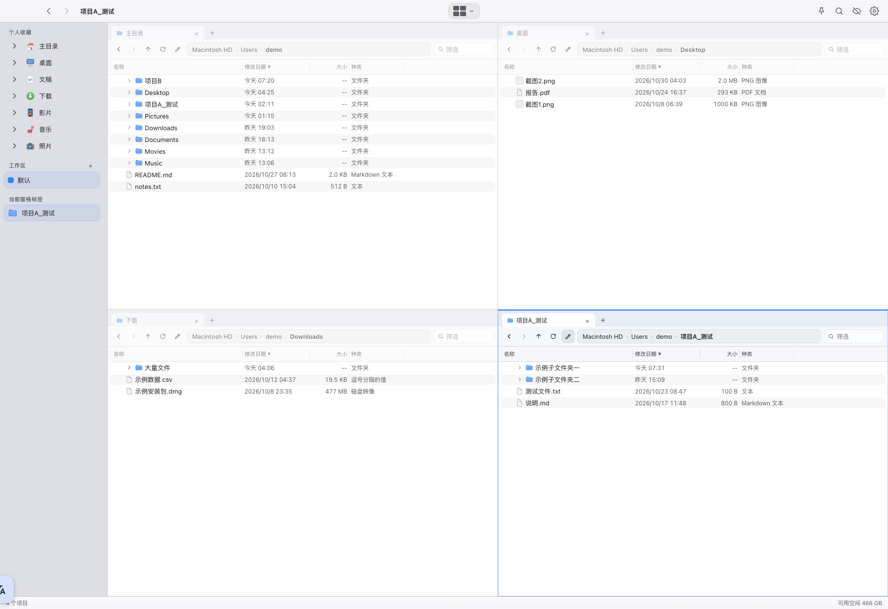
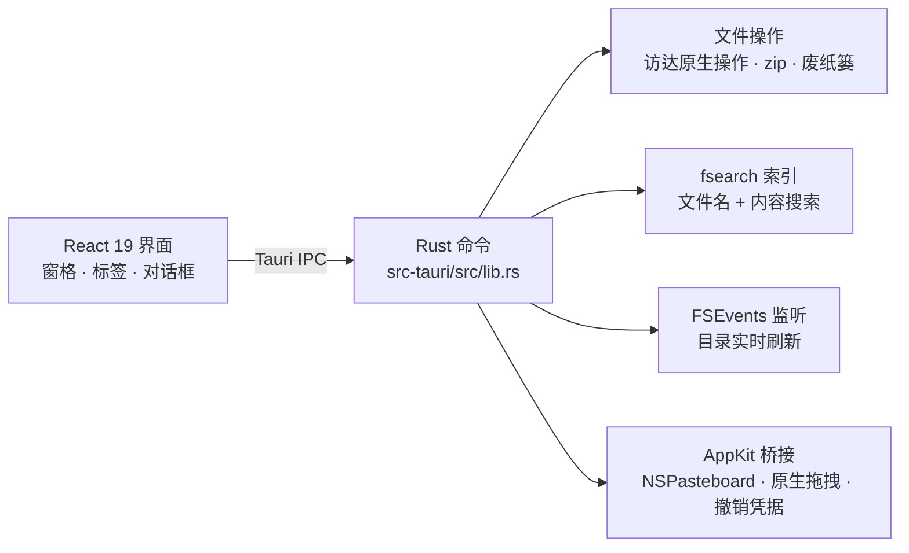

<p align="right">
  <a href="./README.md">English</a> · <strong>简体中文</strong>
</p>

# Bento

<p align="center">
  
</p>

<p align="center">
  <a href="#安装"></a>
  <a href="./LICENSE"></a>
  
  
  
</p>

<p align="center">
  
</p>

<p align="center">
  <a href="#功能">功能</a> ·
  <a href="#安装">安装</a> ·
  <a href="#快捷键">快捷键</a> ·
  <a href="#架构">架构</a> ·
  <a href="#现状与限制">限制</a> ·
  <a href="#致谢">致谢</a>
</p>

## 简介

**Bento** 是一款轻量的 macOS 多窗格文件管理器。多个文件夹像便当盒的格子一样同时摆在眼前，移动、对比、整理文件不必再来回切换窗口。

后端使用 **Rust**（Tauri 2），界面使用 **React 19**。它保留你熟悉的 Finder 操作习惯，并补上进阶用户需要的能力：分屏布局、每个窗格独立的标签页、即时搜索、与其他应用互通的真实拖拽，以及 QSpace 风格的「创建归档」对话框。

> Bento 的交互设计受 [QSpace](https://qspace.awehunt.com/) 启发，是独立的源码可用项目，与 QSpace 官方无关。

## 功能

| | |
| --- | --- |
| **多窗格布局** | 10 种预设：单窗格、左右分栏、上下分栏、2×2 以及多种三窗格组合。可通过工具栏或「显示」菜单切换。 |
| **标签页与工作区** | 每个窗格各自拥有 Finder 式标签页；当前窗格标签按顺序显示在所有工作区下方，点击即可切换到已有标签。整套布局（窗格、标签、路径）可保存为命名工作区。 |
| **侧边栏文件夹树** | 常用位置使用 macOS 系统侧栏图标。主目录、收藏与卷可逐层按需展开；树默认折叠，只读取和监听已展开分支。点击文件夹名称会在当前窗格打开；读取失败可重试，受限结果提供完整文件夹入口。 |
| **拖拽悬停展开** | 列表中拖着文件停在折叠目录上片刻即可展开其子项，继续拖入更深层文件夹；移开其子树、放下或取消拖拽后，本次自动展开的目录会收起，手动展开的目录保留。 |
| **即时搜索** | 基于 [fsearch](https://github.com/noahdunnagan/fsearch) 索引与 macOS 系统索引的全局文件名搜索：连续名称匹配、`*` / `?` 通配符、`ext:` 后缀过滤、`re:` 正则；另有**内容搜索**，右侧预览并高亮命中行。 |
| **原生拖拽** | 可拖出到访达或任何其他应用，也可从任何地方拖入，或在窗格之间移动。Bento 被其他窗口遮住时也能直接拖出；悬停时目标会高亮提示。 |
| **真实剪贴板** | <kbd>⌘C</kbd> 把真实的文件 URL 写入系统剪贴板，在访达等应用里 <kbd>⌘V</kbd> 直接粘贴出文件本体。也可从剪贴板粘贴文件到 Bento；PNG 和 TIFF 图片也可粘贴为文件。 |
| **快速文件操作** | 普通文件操作使用 macOS 访达 / AppKit。对于隐藏的非启动 APFS 卷上的文件，Bento 使用 macOS FileManager，并在 Bento 窗口中显示原生「保留两者 / 取消」冲突对话框；这一路径没有访达进度界面，也不会自动覆盖已有项目。当前会话中可用 <kbd>⌘Z</kbd> 撤销基础文件操作；撤销凭据仅在本次会话有效，没有历史或队列界面。 |
| **创建归档** | QSpace 风格的对话框：选择位置与文件名，速度快 / 体积小 / 自定义压缩级别，可选密码，支持一键压缩与单独压缩。 |
| **文件右键菜单** | “打开方式”列出系统识别的可用应用，并可选择其他应用；“显示简介”打开访达信息窗口，“快速查看”预览所选项目。支持的压缩包可交给 macOS 归档实用工具解压，遵循系统解压偏好；菜单还提供新建、显示方式、排序和列设置。悬停时，复制路径按钮在原文件图标的固定位置替换显示，不推动展开箭头或文件名；打开方式显示应用原生图标。 |
| **批量重命名** | 替换（支持 $1 等正则捕获组）、添加、格式化（序号、日期）、大小写转换，实时预览前后对比。 |
| **新建文件** | 在窗格空白处右键「新建」：文本文件、Markdown，以及放进 `~/Library/Application Support/com.bento.app/templates/` 的模板（例如 `.docx`）。创建后立刻重命名；重名自动变成 `未命名 2.txt`，不会覆盖。 |
| **紧凑行** | 文件列表行高为紧凑的 21px。 |
| **灵活的列** | 名称 · 修改日期 · 创建日期 · 大小 · 种类。拖动列边界调整宽度，右键表头选择显示哪些列。视图设置提供全局默认值和**按文件夹覆盖**。名称列默认宽度为 260px；长文件名会保留扩展名，列宽超出可视区域时可横向滚动。 |
| **实时刷新** | 文件变化时通过 FSEvents 自动更新窗格和展开的子文件夹；可在设置中关闭。文件操作仍会刷新受影响目录；读取中断时保留已读条目并提供重试。 |
| **键盘优先** | 可编辑地址栏（<kbd>⌘L</kbd>，编辑时 <kbd>Tab</kbd> 补全）、复制路径（<kbd>⌥⌘C</kbd>）、<kbd>Tab</kbd> 切换窗格、<kbd>F5</kbd> / <kbd>F6</kbd> 复制或移动到另一窗格、方向键导航、树形展开、<kbd>空格</kbd> 快速查看、窗口置顶（<kbd>⌥⌘T</kbd>）。在设置、压缩和批量重命名对话框中，<kbd>Tab</kbd> / <kbd>Shift+Tab</kbd> 会在对话框内循环，关闭后焦点会返回打开对话框的控件。 |
| **压缩反馈** | 创建 ZIP 时显示进行状态、用时、实时已生成体积及逐包结果，支持取消并自动定位选中结果；成功提示约 4 秒后自动收起；保留压缩选项及安全撤销，取消时清理未完成 ZIP。 |
| **解压反馈** | ZIP/TAR 后台解压，显示进行状态、用时和每个包的完成／失败结果，可取消，完成后在发起任务的标签自动定位并选中输出文件夹。每个包写入旁边的新文件夹；失败／取消保留并标记部分文件。密码包及不兼容格式可改用系统归档工具。 |
| **偏好设置** | 统一图标侧栏、分组控件和快捷键按键列表，适配浅色／深色及小窗口；⌘, 打开。 |
| **快捷键自定义** | 设置 → 快捷键提供现有 Finder 默认方案、Commander 预设、逐项录制、冲突检测、恢复／清除及独立 JSON 导入导出。文件复制粘贴、撤销及基础导航键保持固定；回车行为仍按通用设置。 |
| **状态全记忆** | 窗口位置与大小、布局、标签、路径、排序、列宽和偏好设置都会在启动时恢复；外观跟随系统浅色 / 深色。 |
| **设置备份** | 在「设置 → 备份」中手动导出或导入带版本号的 JSON 文件，包含通用与侧栏偏好、搜索偏好与范围、收藏夹。不包含压缩设置与密码、会话、标签页、工作区、布局或文件夹视图；导入通过完整校验并保存成功后才替换所含偏好。 |

名称和内容搜索均支持“当前文件夹 / 主目录 / 全局”。单击文件结果或按回车会在聚焦窗格中打开所在文件夹并定位选中文件；文件夹结果直接进入该文件夹。悬停或方向键选择可预览，右键菜单的“打开”才打开项目本身。当前文件夹和主目录只在提交搜索时扫描，可找到尚未入索引的新文件；不递归符号链接目录，并在默认 200 条结果上限前应用范围、隐藏项和格式过滤。目录过大或部分不可读时提示结果未穷尽，失败可重试。局部扫描预算为 2 秒软时限、100000 条目、64 层、每文件 16 MiB、单行 64 KiB。全局名称索引与系统索引并行查询，先显示已返回的结果，再补齐其他来源；延迟返回不会覆盖新查询、最终结果或改变已选中的文件。全局名称搜索要求普通关键词在文件名中连续出现，多个词需同时匹配；结合应用索引和 macOS 系统索引，并在预算内非递归核验已命中项目的同级目录，补充附近尚未入索引的文件。结果仍可能不完整。紧凑搜索面板对齐名称、位置、大小和日期列，种类与排序集中在工具栏，覆盖范围提示可展开查看详情。更新搜索会取消局部工作；不可中断的索引调用隔离在有上限的后台工作线程，过时结果会被忽略。拖入下载的附件或从其他应用粘贴支持的文件 URL，会将副本导入聚焦文件夹。

侧边栏默认宽 220px，可拖动范围为 180–520px，双击分隔条可重置；宽度会记忆。行内重命名会按名称自动扩展，在默认 260px 名称列及可见窗格范围内换行，行高 18px；回车确认，Esc 取消。文件行与搜索结果的复制路径按钮共用固定图标位置，悬停不会推动名称或展开箭头。常用目录使用 macOS 系统侧栏图标。顶部后退/前进使用当前窗格历史。搜索无法访问受保护位置时，设置中可显示完全磁盘访问快捷入口。关于页面可检查最新版本并打开下载页面，不会静默安装更新。

## 安装

### 下载

下载 **[Bento 0.4.0](https://github.com/banduoba/bento/releases/tag/v0.4.0)**，或查看[最新 Releases 页面](https://github.com/banduoba/bento/releases/latest)。

| Mac 类型 | 安装包 | 应用压缩包 |
| --- | --- | --- |
| Apple Silicon（M1 或更新） | [Apple Silicon DMG](https://github.com/banduoba/bento/releases/download/v0.4.0/Bento_0.4.0_macOS_AppleSilicon_arm64.dmg) | [Apple Silicon ZIP](https://github.com/banduoba/bento/releases/download/v0.4.0/Bento_0.4.0_macOS_AppleSilicon_arm64.app.zip) |
| Intel | [Intel DMG](https://github.com/banduoba/bento/releases/download/v0.4.0/Bento_0.4.0_macOS_Intel_x86_64.dmg) | [Intel ZIP](https://github.com/banduoba/bento/releases/download/v0.4.0/Bento_0.4.0_macOS_Intel_x86_64.app.zip) |

打开 DMG 后把 **Bento** 拖进 `/Applications`，或解压对应架构的 ZIP。[SHA256SUMS](https://github.com/banduoba/bento/releases/download/v0.4.0/SHA256SUMS) 提供校验值。Intel Mac 无需 Rosetta。Intel 版本通过交叉编译生成；Intel 原生硬件测试尚待完成。

该构建未经 Apple 公证，首次启动可能被 macOS 拦截：可以 *右键 → 打开*，或者执行一次下面的命令清除下载隔离标记：

```bash
xattr -dr com.apple.quarantine /Applications/Bento.app
```

### 从源码构建

想自己构建？首次构建需要几分钟。

**环境要求**

- Apple Silicon 的 macOS（已测试的目标环境）
- [Node.js](https://nodejs.org/) 22.12 或更新版本（统计服务测试需要 24+）
- [Rust](https://rustup.rs/)（stable）与 Xcode 命令行工具（`xcode-select --install`）

**构建**

```bash
git clone https://github.com/banduoba/bento.git
cd bento
npm install
npm run build
```

应用与磁盘映像输出在 `src-tauri/target/release/bundle/`（`macos/Bento.app` 与 `dmg/`），把 `Bento.app` 拖进 `/Applications` 即可。

**开发**

```bash
npm run dev        # Tauri 开发模式（热更新）
```

**首次启动**

- 应用使用临时（ad-hoc）签名，首次打开 macOS 可能要求确认（*右键 → 打开*）。
- 若希望全局搜索与内容搜索覆盖受保护的位置，请在「系统设置 → 隐私与安全性」中授予 **完全磁盘访问权限**；缺失时 Bento 会在设置里提示。
- 用新构建替换应用后，macOS 可能会丢掉该权限——在列表中移除并重新添加 Bento 即可。

## 使用统计

Bento 向 Cloudflare 统计接口发送随机安装标识、应用版本、macOS 和处理器架构，用于统计首次启动和每日活跃安装量。默认开启，可在「设置 → 关于 → 分享使用统计」关闭。不发送文件、路径、搜索词、账户信息或硬件标识。同一安装每天按 UTC 去重；数字代表已上报的安装量，不是下载次数或准确人数。安装标识和统计偏好不包含在设置备份中。

## 快捷键

macOS 原生菜单栏包含 Bento、文件、编辑、显示、前往、窗口和帮助菜单。<kbd>⌘1</kbd>、<kbd>⌘2</kbd>、<kbd>⌘3</kbd> 可切换聚焦窗格的图标、列表和分栏视图；布局通过工具栏或「显示」菜单切换。原生菜单默认遵循 macOS 系统语言（英语、简体中文或繁体中文）；React 界面目前仅提供中文。

<details open>
<summary><b>常用快捷键</b></summary>

| 快捷键 | 功能 |
| --- | --- |
| <kbd>⌘1</kbd> · <kbd>⌘2</kbd> · <kbd>⌘3</kbd> | 聚焦窗格的图标 · 列表 · 分栏视图 |
| <kbd>⌘T</kbd> · <kbd>⌘W</kbd> · <kbd>⌃Tab</kbd> | 新建标签 · 关闭标签 · 下一个标签 |
| <kbd>⌘K</kbd> 或 <kbd>⌥⌘F</kbd> | 打开搜索 |
| <kbd>⌘L</kbd> 或 <kbd>⇧⌘G</kbd> | 编辑路径 |
| <kbd>Tab</kbd> · <kbd>⇧Tab</kbd> | 在可见窗格之间切换焦点（单窗格不切换）。地址栏编辑时仍用于路径补全 |
| <kbd>F5</kbd> · <kbd>F6</kbd> | 把选中项复制 / 移动到另一窗格的当前文件夹（单窗格不执行） |
| <kbd>⇧⌘C</kbd> | 复制所选文件／文件夹名称，保留扩展名（一行一个） |
| <kbd>⌥⌘C</kbd> | 复制所选项目的完整路径（一行一个） |
| <kbd>⌘[</kbd> · <kbd>⌘]</kbd> | 后退 · 前进 |
| <kbd>⌘C</kbd> · <kbd>⌘X</kbd> · <kbd>⌘V</kbd> · <kbd>⌘D</kbd> | 拷贝 · 剪切 · 粘贴 · 拷贝副本 |
| <kbd>⌘⌫</kbd> · <kbd>⌘Z</kbd> | 移到废纸篓 · 撤销 |
| <kbd>⇧⌘N</kbd> | 新建文件夹 |
| <kbd>↩</kbd> | 打开或重命名（设置 → 通用 → 回车键，默认重命名） |
| <kbd>F2</kbd> | 重命名 |
| <kbd>⌘↓</kbd> | 打开所选项目 |
| <kbd>空格</kbd> | 快速查看；单选文件时，↑ / ↓ 按打开预览的窗格当前文件顺序切换 |
| <kbd>↑</kbd> <kbd>↓</kbd> · <kbd>Home</kbd> <kbd>End</kbd> · <kbd>PgUp</kbd> <kbd>PgDn</kbd> | 移动选择 |
| <kbd>→</kbd> <kbd>←</kbd> | 进入文件夹 / 返回上级 |
| <kbd>⌫</kbd> | 返回上级文件夹 |
| <kbd>⌘A</kbd> · <kbd>Esc</kbd> | 全选 · 取消选择 |
| <kbd>⌘R</kbd> | 刷新 |
| <kbd>⇧⌘.</kbd> | 显示 / 隐藏隐藏文件 |
| <kbd>⌥⌘S</kbd> | 显示 / 隐藏侧边栏 |
| <kbd>⌥⌘T</kbd> | 窗口置顶 |
| <kbd>⌘,</kbd> | 设置 |

移动和废纸篓撤销会恢复原始完整文件名；恢复失败时保留撤销记录以便重试，已恢复的条目不会重复处理。

</details>

## 架构



- **前端**：React 19、Vite 7，列表使用 [@tanstack/react-virtual](https://tanstack.com/virtual) 虚拟滚动。打开目录时大约每 500 条经 Tauri Channel 推一批，只挂载可见行，行按路径做键。
- **后端**：Rust + Tauri 2：rayon 并行扫描目录、macOS 原生文件操作、fsearch 引擎、`notify`（FSEvents）实时监听，以及用 `objc2` 调用原生剪贴板与窗口行为。
- **macOS 集成**：原生菜单、剪贴板文件 URL、拖放、下载附件导入、粘贴图片，以及仅限当前会话的文件操作撤销凭据。
- **拖拽**：拖出使用 [tauri-plugin-drag](https://github.com/crabnebula-dev/drag-rs) 发起原生 `NSDraggingSession`，拖入使用 Tauri 窗口的 drag-drop 事件。

```text
src/                     React 界面（App、Pane、各对话框、列与拖拽辅助）
src-tauri/src/lib.rs     Rust 命令：文件、搜索、剪贴板、监听、归档
src-tauri/tauri.conf.json  窗口与打包配置
```


## 现状与限制

Bento 还很年轻（`0.4.0`），使用前请了解：

- 应用界面目前**仅有简体中文**；原生菜单文字遵循 macOS 首选语言（英语、简体中文或繁体中文）。
- 请按架构选择安装包：`AppleSilicon_arm64` 或 `Intel_x86_64`。Intel 版本通过交叉编译生成；Intel 原生硬件测试尚待完成。Intel Mac 无需 Rosetta。
- 仅支持本地文件，暂不支持 SFTP / SMB / 云盘连接。
- 归档密码使用传统 ZipCrypto（macOS 与 `unzip` 都能解压，但加密强度较弱），压缩期间密码会以命令行参数形式传给 `zip`；勾选「保持」会把密码明文保存在配置文件中。

## 性能基线

夹具生成和无界面计时在 [`scripts/bench/README.md`](./scripts/bench/README.md)。脚本可生成约 1 万和 10 万个文件的目录，并测量目录扫描及重命名/恢复代理操作；它不测量访达原生文件操作或 React 首屏。冷启动首屏、新建标签需要在 Mac 上按文档手测，并把数字写入同一份 JSON / Markdown 报告。这些脚本不改变列表、监听或界面的行为。

## 参与贡献

欢迎提交 Issue 和 Pull Request。提交前请运行 `npm run build`；修改 Rust 代码时还请在 `src-tauri/` 下运行 `cargo test`。界面改动附上截图或短录屏会很有帮助。

## 致谢

- [QSpace](https://qspace.awehunt.com/)：本项目交互设计的灵感来源
- [fsearch](https://github.com/noahdunnagan/fsearch)：索引与内容搜索引擎
- [Tauri](https://tauri.app/)、[tauri-plugin-drag](https://github.com/crabnebula-dev/drag-rs)、[notify](https://github.com/notify-rs/notify)、[rayon](https://github.com/rayon-rs/rayon)、[objc2](https://github.com/madsmtm/objc2)
- [React](https://react.dev/)、[Vite](https://vite.dev/) 与 [TanStack Virtual](https://tanstack.com/virtual)

## 许可证

[Bento Source-Available License 1.0](./LICENSE) © banduoba。这是自定义的源码可用许可证，不是 OSI 认可的开源许可证。

- 允许免费个人使用，以及使用未修改的软件进行日常内部办公。
- 售卖软件、收费提供访问或基于软件的服务、商业捆绑，以及商业二次开发，需要相关权利人另行授权。
- **任何修改都必须在作出修改时公开完整对应源码，并沿用相同条款，包括个人或私下修改；运行、测试前必须先公开。** 本许可不允许闭源私人修改。
- 本次变更不收回早前已按 MIT 授予的权利；第三方组件继续适用各自许可证。

详见[许可说明和新旧授权边界](./LICENSING.md)。
